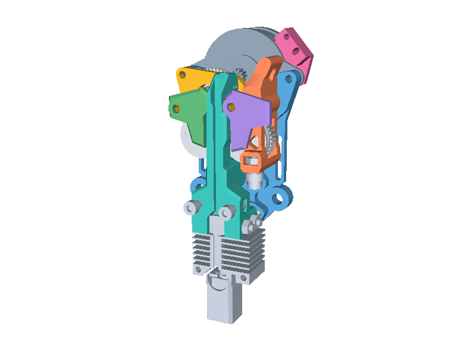
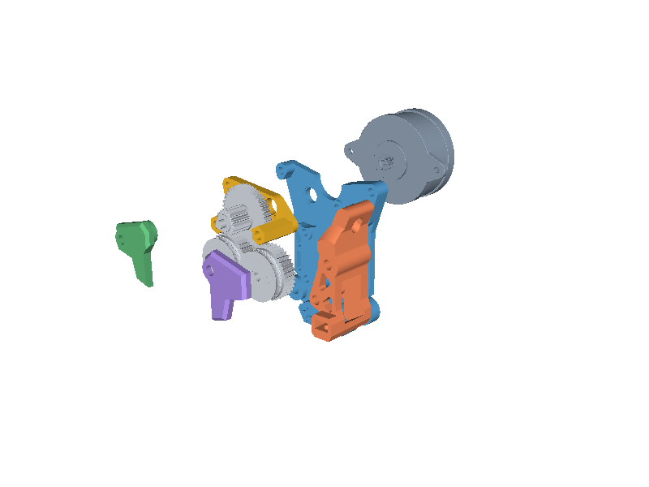
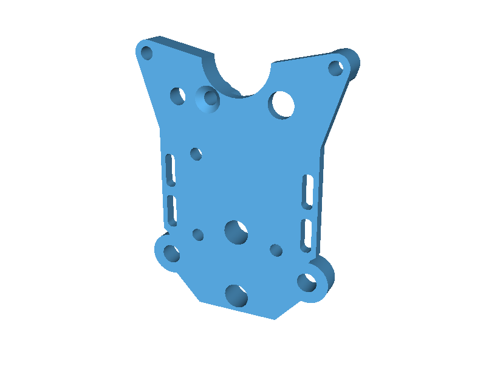
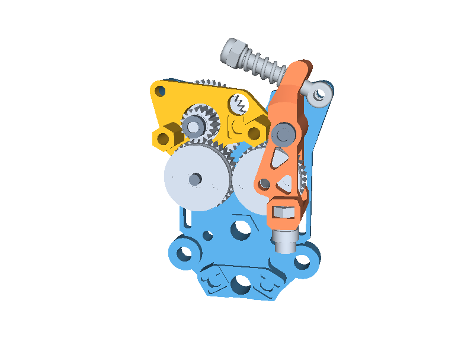
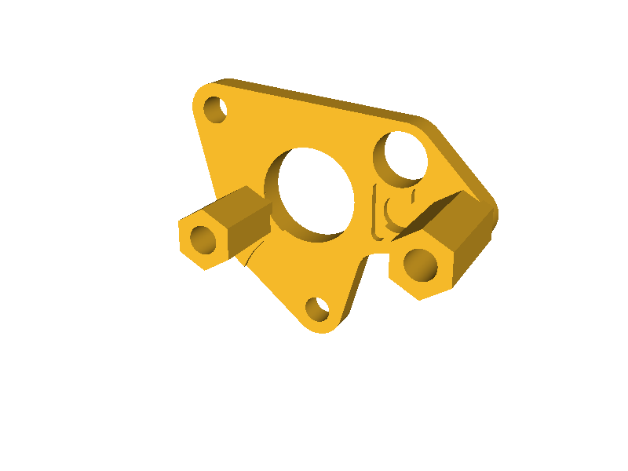
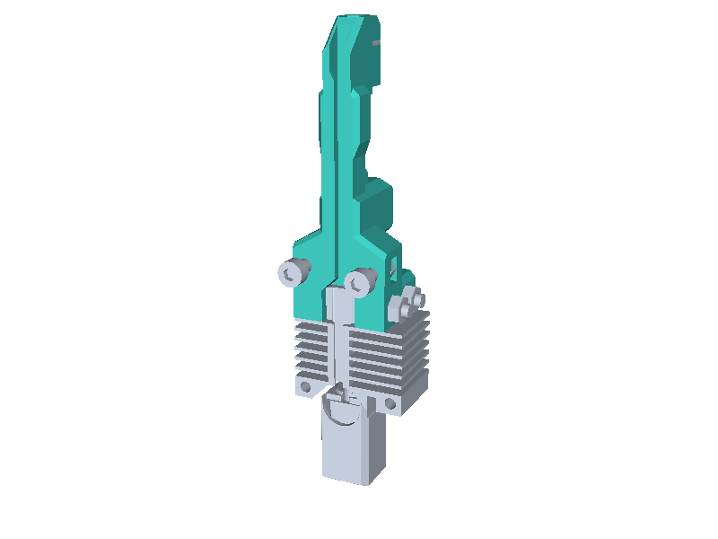
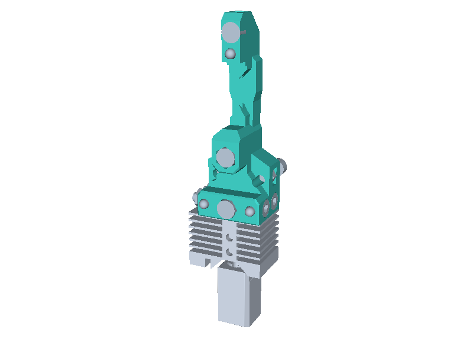
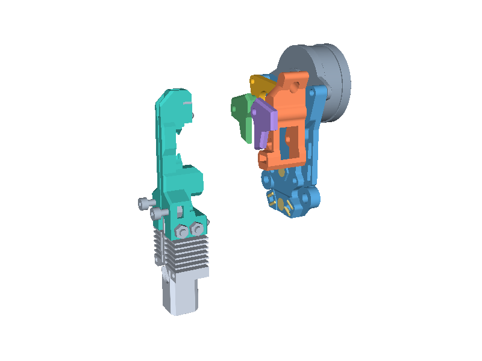
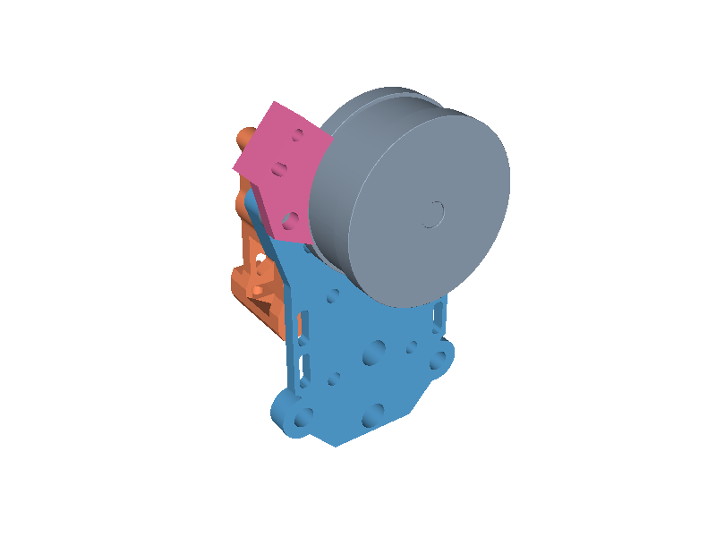

# M3DP Changer B1 illustrated assembly guide

This guide covers the eight B1 pieces you printed: the adapted P1/P3/P4/P5 plate set, one printed P8 arm, one detector mount and two hotend holders. Colors identify parts throughout the illustrations; they do not prescribe filament colors. The pictures use installed CAD positions, not print orientations.

[Printable illustrated guide (10 pages)](../../../../output/pdf/CxChanger-B1-illustrated-assembly-guide.pdf)

The motor is on the **carriage side**. The teal hotend holder is on the **coupling/module side**, with the nozzle pointing down. Only one hotend module attaches to the head at a time.

## Identify your prints

| Color / part | STL in the repository's `stl/` folder | Quantity |
|---|---|---:|
| Gold P1 - magnet plate with integral pillars | `p1-magnet-plate-integral-pillars-print-flat.stl` | 1 |
| Green P3 - left cover | `p3-cover-left-clamp-web-print-flat.stl` | 1 |
| Purple P4 - right cover | `p4-cover-right-clamp-web-print-flat.stl` | 1 |
| Blue P5 - backplate | `p5-backplate-two-inserts-through-bolt-print-flat.stl` | 1 |
| Orange P8 - one-piece arm | `p8-printed-bearing-arm.stl` | 1 |
| Pink - detector mount | `tool-detector-mount-PROTOTYPE.stl` | 1 |
| Teal - hotend holder | `hotend-holder.stl` | 2 |

Use the matching adapted P1/P3/P4/P5 together. The one-piece P8 replaces the CNC alternative: do not add P2, P6 or P7 or their duplicated roller hardware. Keep these B1 parts for the build; earlier fit coupons are test pieces.

## 1. Understand the head layers

P5 is the carriage-side plate. P1's two integral pillars point toward the covers. P3 and P4 close over the drive mechanism. P8 pivots beside the gears. The exploded offsets only separate components for visibility; they are not assembly distances.

Identify P5's holes and fit the long countersunk bolts before the motor and gears restrict access to their heads. Fit pins/bearings/gears and P8 before closing the covers. Seat everything squarely before tightening.

## 2. Prepare P5

The two lower outer P5 holes have **4.6 mm bores** prepared for M3 heat-set inserts, nominal 5 mm outside diameter x 4 mm long. These are the **original blower interface**, and no active B1 attachment to them is documented after the blower was relocated. Leave them unused during this dry-fit; already-installed inserts can remain. Do not allocate the relocated top-blower screws to these holes. They are not the separate TAP-adapter insert locations.

The upper countersink receives the **M3 x 30 rear through-bolt**. This is a clearance connection, not an insert seat. P1's pillar bores also take through-bolts, not heat-set inserts.

## 3. Assemble the drive and P8

Use the HGX 17/44T compound gear and **two** 36T drive gears: one fixed and one carried by P8. Retain all three MR63ZZ bearings (3 x 6 x 2.5 mm): two support the compound-gear axis in P5 and P3; the third seats in P4 at the P8 pivot. The fixed gear uses a 3 x 16 mm pin; the P8 pivot uses the 3 x 24 mm pin. Keep the spring, hollow bolt and M4 lock nut in their source arrangement.

P3's other round opening takes the fixed-gear pin; P4's circular recess takes the pivot bearing. These are not additional screw holes.

The small roller at the bottom of P8 uses this stack:

**M3 x 8 screw head → 683ZZ bearing (3 x 7 x 3) → washer (3.2 x 6 x 0.5) → P8 → M3 nut.**

The roller must turn freely. This is a separate joint from the drive-gear shaft.

**P8 gear-shaft check:** the saved source places the second 3 x 16 mm pin beside the unused CNC arm, not at the selected P8 gear. These illustrations omit that misplaced pin. Confirm the P8 gear's shaft seating and retention on the bench before considering the head assembled; the source does not establish the installed shaft position or retention.

## 4. Close the two integral-pillar joints

| Joint | Hardware order |
|---|---|
| Left, 10 mm pillar | M3 x 20 countersunk head on P1 → integral P1 pillar → P3 → washer → M3 nut |
| Rear, 14 mm pillar | M3 x 30 countersunk head on P5 → integral P1 pillar → P4 → washer → M3 nut |

Use 90-degree countersunk heads with **actual diameter no larger than 5.6 mm**. Countersunk length includes the head. Each outside washer is 3.2 mm ID, at most 7 mm OD and 0.5 mm thick; each nut is 5.5 mm across flats and 2.4 mm thick. Both heads must stay recessed. No metal standoffs are added at these two pillars.

The left motor ear retains its **M3 x 15 socket-head screw**, with the head against P1 and the shaft pointing toward P5/motor; no additional left nut is shown in the selected assembly. The right motor ear uses the **M3 x 22 detector anchor** described in step 7. Check actual motor thread engagement; the CAD does not establish tightening torque.

Seat P3/P4 squarely, then snug the nuts. Turn the gear train through complete revolutions and move P8 through its full stroke. Check the rear washer/nut against the hotend holder during attachment and removal. Do not tighten further to overcome binding or a poorly seated print.

## 5. Build T0 and T1 hotend modules

For each holder:

1. Seat a Bambu P1P hotend in the lower pocket, nozzle down.
2. Fit **two M3 x 22 socket-head screws** through the transverse clamp holes and their matching nuts.
3. Fit the separate **two magnetic-head M3 x 10 socket-head screws** as docking hooks, with axes 15 mm apart. Each module uses four M3 nuts in total.
4. Label the completed modules T0 and T1.

The long transverse screws clamp the hotend. The short outward-facing cap heads engage the dock. Check that the actual hook heads attract the dock magnet.

## 6. Fit and test the coupling

Each holder takes three N52 6 x 4 mm magnets and three round-head 3 x 4 mm locating pins. The head takes three opposing magnets and six 1.5 x 5 mm cylindrical pins arranged as three locating grooves.

Check the polarity of each opposing magnet pair before securing magnets. All pairs must attract. The round-head pins contact the cylindrical-pin grooves; **the opposing magnets retain a small gap** rather than serving as the locating stops.

Attach one module at a time. Seat and remove T0, then T1. Confirm all three locating contacts seat without rocking or snagging, and check clearance to the P4 nut and washer.

## 7. Fit the detector

The pink mount sits directly on the motor mounting ear; **no spacer belongs underneath**.

1. Replace the source M3 x 16 button-head anchor with **M3 x 22**. Retain the existing M3 nut below P5 and add a second M3 nut above the detector. No extra anchor washer is included in the checked stack.
2. Attach the D2F-01F switch using **two M2 x 18 socket-head screws**, two M2 nuts and four M2 washers (5 mm OD, 0.4 mm thick), one washer on each side of each joint. The round hole provides the pivot and the arc slot provides angular adjustment; centers are 6.5 mm apart.
3. Face the switch plunger toward the P8 actuator. The switch is omitted from the CAD views. Move P8 by hand and adjust without bottoming the plunger.

Required repeatable responses:

| Physical condition | Required signal |
|---|---|
| Empty head | Not detected |
| Tool present, no filament | Not detected |
| Tool present with filament | Detected |

## 8. Finish the bench check

- Plates sit squarely; through-bolt heads are recessed; nuts and washers clear moving and removable parts.
- Gears turn through complete revolutions; P8 moves through its full stroke; roller spins and shafts remain seated.
- Both T0 and T1 locate repeatably, with three locating contacts and a magnet gap.
- The detector repeats the required truth table.
- The P8 gear shaft installation and retention are confirmed physically.

The next stage is TAP/top-blower and dock integration, covered separately under `voron-integration/`. Wiring, heating and automatic movement are not part of this B1 bench guide.

## Source and validation

These illustrations use the actual corrected-6.11 assembly, adapted plates and detector mount. They establish identity and CAD orientation; printing completion does not establish assembled performance. See [source-audit.md](source-audit.md) for the exact source hash, selected/omitted alternatives, transforms, hardware relationships and known P8 pin omission. The assembly order is a CAD-derived bench aid, not a physically validated upstream procedure.

Rebuild the PDF with `build_guide.py` using Python with ReportLab. CAD renders are saved under `images/`; the composition script does not generate or modify CAD.
